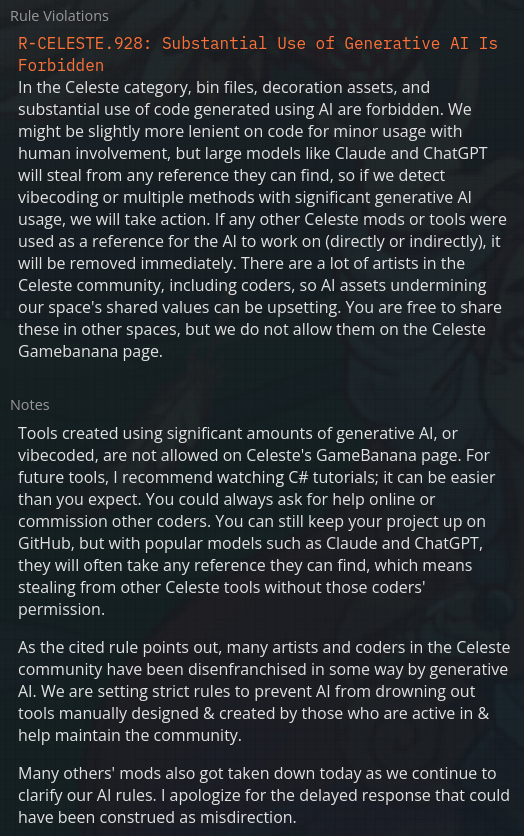
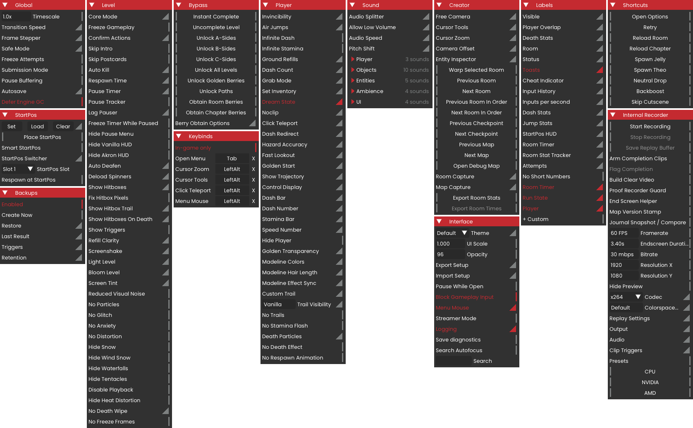

<p align="center">
  
</p>

## why i'm ending development

i'm disappointed by the new rule against substantial AI use in the Celeste section of GameBanana. i spent months building Akron to give something back to the modded Celeste community. if i uploaded it there now, it would be removed under this rule. i think the rule is extreme, and it feels like those months of work went to waste before i even got a chance to launch it there.

i think the explanation below is completely uninformed and ignorant about how AI is used in software development today. it reads like it was written by people who haven't worked in the industry recently.

i'm ending development on Akron. i'll reconsider if the rule changes. the source code and both [1.0.0 downloads](https://github.com/Microck/akron/releases/tag/v1.0.0) will stay up on GitHub.





## what is Akron?

Akron is a player-facing utility suite for Celeste that runs inside Everest. it centers on an in-game overlay for practice, routing, hud visibility, capture, setup sharing, and visible attempt status.

the overlay keeps common player tools close to the game instead of scattered across separate menus. players can check the current setup, adjust practice or hud surfaces, capture play, and move back into the level without changing context.

this is the offline edition of Akron. it keeps local `.akr` setup import and export, but omits the online catalog, submissions, and automatic reports. download `Akron-Offline-v1.0.0.zip` from [GitHub Releases](https://github.com/Microck/akron/releases), and keep only one Akron ZIP in your Everest `Mods` folder because both editions share the same mod ID.

## quickstart

1. download the versioned Akron ZIP from [GitHub Releases](https://github.com/Microck/akron/releases) and place it unopened in your Everest `Mods` folder.
2. launch Celeste through Everest.
3. press `Tab` to open Akron.

## what does it include?

### overlay and hud

the tabbed in-game overlay includes hud widgets for labels, inputs, timers, resources, stats, and setup state. it is the main surface for checking and changing options while staying inside Celeste.

### practice and routing

startpos tools, retry and reload helpers, frame and timescale controls, and room-lab utilities are grouped around setup, routing, and quickly returning to the part of a map that needs practice.

### status and policy

policy badges show each row's classification. the attempt-status chip shows the strictest classification Akron recorded for the current attempt. community submission rules remain the authority for run acceptance.

### .akr setup packs

`.akr` setup packs save, import, and share scoped Akron setups. use Export Setup to save a file and Import Setup to load one shared by another player. Both work offline.

### capture tools

screenshots and internal recording support sharing or reviewing play.

see the [feature guide](docs/feature-guide/) for the current option reference.

## external integrations

some overlay rows appear only when supported external mods are installed. Akron does not depend on, bundle, or replace those tools; it provides a visual gui for ease of use. each tool remains a separate installation:

- **[Motion Smoothing](https://gamebanana.com/mods/514173):** controls for fps/tps bypass settings and related smoothing options.
- **[Speedrun Tool](https://gamebanana.com/tools/6597):** status, savestate slots, capture/restore/clear actions, room timer export, and optional Lag Pauser handling for load-state hitches.
- **[CelesteTAS](https://gamebanana.com/tools/6715):** tas status, the configured tas file, and a playback handoff.
- **[Extended Variant Mode](https://gamebanana.com/mods/53650):** available variant options exposed by the mod.
- **[Extended Camera Dynamics](https://gamebanana.com/mods/548940):** camera hook status and Cursor Zoom zoom-out support when ECD camera hooks are active.

see the [compatibility](docs/troubleshooting/compatibility.mdx) and [external integrations](docs/feature-guide/external-tools.mdx) docs for details.

## contributing

Akron is a .NET Everest mod. for local development:

```bash
dotnet format Akron.sln --include Source/Core/AkronFeatureRegistry.cs tests/feature-registry-tests.cs
dotnet build Source/Akron.csproj
dotnet test tests/akron-tests.csproj --nologo
```

read the [contributor docs](docs/contributing/development-setup.mdx) before changing feature policy, setup packs, or public behavior.

## support

if Akron helps with your Celeste practice, routing, captures, or setup sharing, optional support is available on [ko-fi](https://ko-fi.com/microck). donations help cover ongoing development costs, so they help keep the mod maintained. no features are or will be locked behind donations or a paywall.

<p align="left">
  <a href="https://ko-fi.com/microck">
    
  </a>
</p>

## license

Akron-owned material is licensed under [Creative Commons Attribution-NonCommercial-NoDerivatives 4.0 International](LICENSE). Third-party components remain under the separate terms listed in [third-party notices](licenses/third-party-notices.txt).
